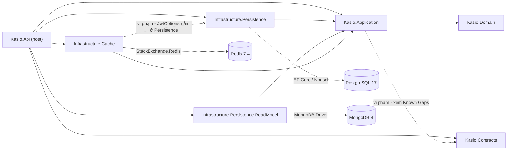

# Repository Guidelines

## Project Overview

Kasio là ASP.NET Core **.NET 10** (C# 14) DDD API với write/read split. Các project:

`Kasio.Domain`, `Kasio.Contracts`, `Kasio.Application`, `Kasio.Infrastructure.Persistence`,
`Kasio.Infrastructure.Persistence.ReadModel`, `Kasio.Infrastructure.Cache`, host `Kasio.Api`.
Hạ tầng local: `docker-compose.yml` (PostgreSQL 17, MongoDB 8, Redis 7.4, RabbitMQ 4.1).

Trạng thái hiện tại (2026-11-27): **build xanh, 38 unit test pass**. Đã có đầy đủ
auth (JWT + refresh token Redis), quản trị user/role/permission, EF migration, CAP outbox.
Read model Mongo mới chỉ đăng ký client — chưa có collection/handler.

## Architecture & Data Flow



Runtime: `Program.cs` → Serilog → `AddApplication` (MediatR + validators + behaviors) →
`AddPersistence` / `AddPermissionAuthorization` / `AddCache` / `AddReadModel` → health checks →
JWT auth → CORS → `UseExceptionHandler` + `UseStatusCodePages` → `/health/live`, `/health/ready` →
controllers. Development có `/openapi` và `/scalar` (redirect `/` → `/scalar/index.html`).

### Domain model

| Type | File | Ghi chú |
| --- | --- | --- |
| `Entity<TId>`, `AggregateRoot<TId>`, `IDomainEvent`, `IAggregateRoot` | `src/Kasio.Domain/Common/` | Event collection + `RaiseDomainEvent`; `ClearDomainEvents` công khai qua `IAggregateRoot` |
| `User : AggregateRoot<UserId>` | `src/Kasio.Domain/Users/User.cs` | `Create` → `ErrorOr<User>`; `AssignRole`; `SetPermission`; `Deactivate` |
| `UserPermission`, `PermissionEffect`, `Gender`, `EmailNormalizer` | `src/Kasio.Domain/Users/` | `EmailNormalizer` là nơi duy nhất chuẩn hóa email |
| `Role : AggregateRoot<RoleId>`, `RoleNames`, `RolePolicy`, `RoleErrors` | `src/Kasio.Domain/Roles/` | `RolePolicy` là nguồn sự thật cho ai tạo/quản lý role nào |
| `Permission`, `PermissionId`, `PermissionCatalog`, `PermissionGrantPolicy`, `PermissionGrantViolation` | `src/Kasio.Domain/Permissions/` | `PermissionCatalog` chứa mã quyền + `OwnerOnly` + `IsPlatform` |
| Repositories | `src/Kasio.Domain/Repositories/` | `IUserRepository`, `IRoleRepository`, `IPermissionRepository` |

Domain events (đều dùng `DateTime.UtcNow`, `EventType` lấy từ `*EventTypes`):

| Event | EventType | Phát khi |
| --- | --- | --- |
| `UserCreatedDomainEvent` | `User.Created` | `User.Create` (không chứa `PasswordHash`) |
| `UserDeactivatedDomainEvent` | `User.Deactivated` | `User.Deactivate` (idempotent) |
| `AssignUserRoleDomainEvent` | `User.AssignRole` | `User.AssignRole` (xóa toàn bộ override, có cờ `HadOverrides`) |
| `UserPermissionGrantedDomainEvent` | `UserPermission.Granted` | `SetPermission(Allow)` tạo mới hoặc đổi Deny→Allow |
| `UserPermissionDeniedDomainEvent` | `UserPermission.Denied` | `SetPermission(Deny)` tạo mới hoặc đổi Allow→Deny |
| `UserPermissionRemovedDomainEvent` | `UserPermission.Removed` | `SetPermission(Inherit)` khi đang có override |
| `RoleCreated/Updated/Deleted/PermissionGranted/PermissionRemoved...` | `Role.*`, `RolePermission.*` | các method tương ứng của `Role` |

`SetPermission` chỉ phát event khi trạng thái **thực sự thay đổi** (BRD 11.1 yêu cầu audit).

## API surface

| Method | Route | Policy | Ghi chú |
| --- | --- | --- | --- |
| POST | `/api/auth/login` | anonymous | sai thông tin/khóa tài khoản → **401** |
| POST | `/api/auth/refresh` | anonymous | rotation, dùng lại token cũ → revoke toàn bộ phiên |
| POST | `/api/auth/logout` | anonymous | revoke 1 refresh token |
| POST | `/api/auth/logout-all` | `[Authorize]` | revoke mọi refresh token của user hiện tại |
| GET | `/api/auth/me`, `/api/auth/me/permissions` | `[Authorize]` / `[Authorize]` | |
| GET | `/api/users` (page, pageSize, search) | `user.read` | pageSize 1..100 |
| GET | `/api/users/{id}` | `user.read` | |
| POST | `/api/users` | `user.create` | body bắt buộc `roleId`; Admin chỉ tạo Owner |
| PUT | `/api/users/{id}/role` | `staff.manage` | Owner gán role dưới mình |
| PUT | `/api/users/{id}/permissions` | `staff.manage` | theo BR-44/BR-48/mục 10 |
| DELETE | `/api/users/{id}` | `user.delete` | **soft delete** (`IsActive=false`), chặn Owner/Admin/chính mình |
| GET | `/api/users/{id}/permissions` | `user.read` | trạng thái Inherit/Allow/Deny |
| GET/POST/PUT/DELETE | `/api/roles...` | `role.read/create/update/delete` | chỉ Owner tạo/sửa role tùy chỉnh |
| GET | `/api/permissions` | `permission.read` | |
| GET | `/health/live` | anonymous | process còn sống; **không** chạm hạ tầng |
| GET | `/health/ready` | anonymous | Postgres + Mongo + Redis (timeout 5s mỗi check) → 503 nếu có check Unhealthy; body JSON có `status`, `totalDurationMs`, `checks[]` (`Health/HealthCheckResponseWriter.cs`) |

Quy tắc phân quyền đang áp dụng (BRD):

- **BR-44**: chỉ cấp/thu hồi quyền mình đang có; không đổi vai trò/quyền của Owner; Platform Admin
  không bị quản lý qua API tenant.
- **BR-48**: `staff.manage` và `tenant.settings.write` chỉ thuộc Owner, không cấp qua role tùy chỉnh.
- **§10**: quyền `platform.*` không gán cho tenant.
- `RolePolicy.CanCreateAccount`: Admin → chỉ Owner; Owner → role dưới mình; không ai tạo `admin`.
- `RolePolicy.CanManageAccount`: dùng cho gán role và soft delete.
- `PermissionGrantPolicy.Check`: một chỗ duy nhất cho 3 luật trên.

## Key Directories

| Path | Nội dung |
| --- | --- |
| `host/Kasio.Api` | `Program.cs`, `Controllers/` (Auth, Users, Roles, Permissions, `ApiController` base), `Authorization/`, `Health/`, `appsettings*.json`, launch profile (5080) |
| `src/Kasio.Domain` | Base types, aggregates, events, `RolePolicy`, `PermissionGrantPolicy`, repository interfaces |
| `src/Kasio.Contracts` | DTO công khai (Auth, User, Role, `PagedResponse`) |
| `src/Kasio.Application` | Handlers/validators theo feature, `Common/Behaviors`, `Common/Interfaces`, `Common/Messaging` |
| `src/Kasio.Infrastructure.Persistence` | `KasioDbContext`, configurations, repositories, `UnitOfWork`, `UserPermissionReader`, seeders, `Security/` (JWT, BCrypt), `Messaging/CapEventPublisher`, `Migrations/` |
| `src/Kasio.Infrastructure.Cache` | `RedisConnection` (ConnectAsync một lần), `RedisRefreshTokenStore` |
| `src/Kasio.Infrastructure.Persistence.ReadModel` | Chỉ `DependencyInjection` (Mongo client/database) |
| `tests/Kasio.UnitTests` | 5 test class, 38 test |
| `Makefile` | Generator scaffold — **lỗi thời**, xem Known Gaps |

## Development Commands

Yêu cầu: .NET SDK **10.0.100+** (`global.json` rollForward latestFeature, đã chạy 10.0.404),
Docker Desktop. `make` chỉ cần trên Linux (`ensure-dotnet` gọi `sudo dnf`).

```bash
dotnet tool restore                       # dotnet-ef 10.0.15
dotnet restore Kasio.sln
dotnet build Kasio.sln --nologo
dotnet test Kasio.sln --nologo
docker compose up -d --wait
dotnet run --project host/Kasio.Api       # http://localhost:5080, /scalar ở Development
docker compose down -v                    # reset dữ liệu local
```

Tạo migration (chưa có thì thêm):

```bash
dotnet ef migrations add <Name> \
  --project src/Kasio.Infrastructure.Persistence \
  --startup-project host/Kasio.Api
```

`--startup-project` bắt buộc vì `Microsoft.EntityFrameworkCore.Design` chỉ có ở project Api.

## Configuration

Key bắt buộc: `ConnectionStrings:WriteDb`, `ConnectionStrings:Redis`, `Mongo:ConnectionString`,
`Mongo:Database`, `RabbitMQ:HostName`, `RabbitMQ:UserName`, `RabbitMQ:Password`, `Jwt:Secret`
(≥ 32 byte). Thiếu bất kỳ key nào → `InvalidOperationException` lúc khởi động, không có giá trị
mặc định ngầm.

Biến môi trường cho production: `ConnectionStrings__WriteDb`, `ConnectionStrings__Redis`,
`Mongo__ConnectionString`, `Mongo__Database`, `RabbitMQ__HostName`/`__UserName`/`__Password`,
`Jwt__Secret`, `SeedAdmin__Email`/`SeedAdmin__Password` (tùy chọn; thiếu thì seeder bỏ qua).

`appsettings.Development.json` chứa giá trị dev (Postgres trust không mật khẩu, RabbitMQ
`kasio/kasio`, Redis 6380, `Jwt:Secret` dev, `SeedAdmin` throwaway). `Database:MigrateOnStartup`
chỉ bật ở Development → tự migrate + seed permission/role/admin khi khởi động.

> `appsettings.json` (file commit) **không chứa credential**: `Jwt:Secret` để rỗng,
> `SeedAdmin:Password` để rỗng, `RabbitMQ:Password` không có, connection string không có password.
> Endpoint localhost vẫn còn. Production phải cấp đủ qua biến môi trường, nếu không app dừng ngay
> lúc khởi động. `ARCHITECTURE.md` vẫn ghi "no endpoints" — chưa đúng ở phần endpoint.

## Conventions & Invariants

- **Dependency direction:** `Domain`/`Contracts` không tham chiếu project khác; `Application` chỉ
  tham chiếu `Domain`; `Persistence`/`ReadModel`/`Cache` tham chiếu `Application`; `Api` tham chiếu
  tất cả. Hiện có 2 vi phạm đã biết (xem Known Gaps) — đừng thêm vi phạm mới.
- **Một DI extension mỗi project**, gộp trong `Program.cs`. Không đăng ký handler/validator thủ công.
- **MediatR + FluentValidation quét assembly.** `ValidationBehavior` trả `ErrorOr` (không throw);
  `ApiController.Problem` đổi `ErrorType.Validation` → 400 `HttpValidationProblemDetails`, các loại
  khác → 400/401/403/404/409 theo `ErrorType`.
- **Command bọc transaction qua marker:** `ICommand<T>` kế thừa `ICommandBase`; `UnitOfWorkBehavior`
  ràng buộc `TResponse : IErrorOr` và kiểm tra `request is ICommandBase` lúc chạy. **Không** đổi sang
  `where TRequest : ICommand<TResponse>` — MediatR đóng open behavior bằng `ErrorOr<X>` nên ràng buộc
  đó không bao giờ thoả và behavior bị DI bỏ qua (bug đã từng xảy ra: write trả 201 nhưng mất dữ liệu).
- **Aggregates:** private parameterless ctor cho EF, mutate qua method, collection `IReadOnlyList`,
  raise event khi state đổi, `DateTime.UtcNow` (Npgsql `timestamptz` từ chối `Unspecified`).
- **Email là định danh:** `EmailNormalizer.Normalize` (trim + lowercase) dùng ở `User.Create` và khi
  tra cứu; unique index trên `Users.Email`.
- **Password hash không đi lên message bus**; auth đọc write DB.
- **EF Core:** mapping trong `IEntityTypeConfiguration<T>` + `ApplyConfigurationsFromAssembly`; không
  map trong `OnModelCreating`.
- **Outbox:** `UnitOfWork.SaveChangesAsync` publish domain event qua CAP trong cùng transaction; chỉ
  clear event sau khi `SaveChanges` thành công. Seeder clear event trước khi lưu (CAP chưa chạy).
- **Analyzers là build blocker:** `TreatWarningsAsErrors`, `AnalysisLevel latest`,
  `Meziantou.Analyzer`. Hay gặp: MA0006 (`string.Equals` thay `==`), MA0011 (`ToLower` cần culture —
  tránh dùng trong LINQ to EF), MA0048 (một public type mỗi file, tên file = tên type),
  MA0051 (hàm ≤ 60 dòng).
- **Serilog only**, compact JSON ra console + `logs/log-<date>.txt`, giữ 7 ngày.

## Testing

xUnit 2.9.3 + `Microsoft.NET.Test.Sdk` 17.14.2. 5 test class, 38 test, không cần hạ tầng:

```bash
dotnet test Kasio.sln -c Debug --nologo
dotnet test tests/Kasio.UnitTests/Kasio.UnitTests.csproj --filter "FullyQualifiedName~RolePolicyTests"
```

| File | Phạm vi |
| --- | --- |
| `ValidationBehaviorTests.cs` | trả `ErrorOr` khi rule fail, gọi `next` khi pass |
| `RolePolicyTests.cs` | ma trận tạo/quản lý tài khoản theo role |
| `PermissionGrantPolicyTests.cs` | 3 luật BR-44/BR-48/§10 |
| `UserEmailTests.cs` | email lưu lowercase + idempotent |
| `DomainEventTests.cs` | event permission (Granted/Denied/Removed), idempotent, UTC, Deactivate |

Test project chỉ tham chiếu `Application` (kéo theo `Domain`); không có test hạ tầng/HTTP — thêm
project riêng nếu cần, đừng phá ranh giới này.

## Known Gaps & Gotchas

- **Vi phạm dependency (đã biết):** `Kasio.Application` tham chiếu `Kasio.Contracts`
  (`src/Kasio.Application/Kasio.Application.csproj:5`) và trả DTO Contracts trực tiếp;
  `Kasio.Infrastructure.Cache` tham chiếu `Persistence` + `ReadModel` để dùng `JwtOptions`.
  Sửa cần tách DTO nội bộ + Mapperly ở Api, và chuyển `JwtOptions` ra project dùng chung.
- **Chưa có tenant/membership/property scope** (BRD 3.2). RBAC hiện chỉ theo thứ hạng role, nên
  chưa cách ly dữ liệu giữa các Owner.
- **Chưa có audit log** (BRD 11.1/AC-ADT-01). Domain event đã phát nhưng không có consumer ghi audit.
- **Credential trong `appsettings.json`** (xem mục Configuration).
- **Health check chỉ phủ Postgres/Mongo/Redis.** RabbitMQ/CAP không được probe; `/health/ready`
  chưa trả chi tiết khi Redis chết ở tầng auth (auth vẫn 500, không phải 503). Lần probe đầu tạo
  multiplexer Redis mới (~2s), các lần sau ~2-4ms.
- **Không có rate limit / account lock**; role `user.create` không giới hạn tần suất.
- **`Phone` chưa unique** dù BRD 3.2 nói định danh bằng email **hoặc** số điện thoại.
- **Access token 60 phút, refresh 7 ngày**; BRD NFR-SEC-03 ghi 15 phút / 30 ngày.
- **Read model trống:** mới có `IMongoClient`/`IMongoDatabase`; chưa có collection, `$jsonSchema`,
  index hay consumer CAP. Query handler hiện đọc thẳng PostgreSQL (trái BR-50, chưa có read model).
- **Hangfire chưa wire** (`Hangfire.AspNetCore`/`Hangfire.PostgreSql` chỉ tham chiếu). CAP đã wire.
- **`Makefile` lỗi thời:** block `APPSETTINGS_DEV` vẫn sinh `Jwt:SigningKey` (code đọc `Jwt:Secret`),
  `Program.cs` mẫu còn `ValidationExceptionHandler`/health checks, Redis 6379. `make files` chỉ ghi
  file **thiếu** nên không ghi đè bản đang có; `make init` trên thư mục trống tạo ra scaffold cũ tự
  nhất quán nhưng khác code hiện tại — trộn file do Makefile sinh với code hiện tại thì app không
  khởi động (thiếu `Jwt:Secret`). Đừng dùng Makefile làm nguồn sự thật.
- **Redis trên host port 6380** vì service Redis của Windows giữ 6379; `ConnectionStrings:Redis`
  trong Development là `localhost:6380`.
- **`RedisRefreshTokenStore` fail 500 khi Redis chết** — chưa có fallback/circuit breaker.
- **Xung đột BRD:** FR-ACC-02 nói Owner tự đăng ký, nhưng API hiện tại để Admin tạo Owner.
  Khi làm tenant cần chốt lại luồng này.
- **Chưa có README, CI workflow.**

## Graphify (local only)

`graphify-out/` nằm trong `.gitignore`; không commit. Rebuild sau khi đổi code (AST-only):

```bash
python -m graphify update .
python -m graphify query "<câu hỏi>" --budget 600
python -m graphify god-nodes --top 15
python -m graphify explain "<node label>"
python -m graphify affected "<symbol>"
```
